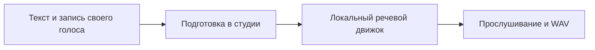

# Моя аудиокнига

**Локальная студия аудиокниг** — учебный проект для Windows: подготовка текста,
запись своего голоса и озвучивание на собственном компьютере. Идея проекта —
собрать эти действия в одном понятном интерфейсе и разобраться, как связать
обычное приложение с локальными речевыми моделями.

Цель — пройти путь от текста и записи до аудиокниги в WAV. Основные задачи:
сохранять проекты, разбивать текст на фрагменты, готовить записи для обучения
и давать возможность прослушать результат до озвучивания всей книги.



## Что уже есть

- Проекты, загрузка WAV и голосовых сообщений, подтверждение голосового образца.
- Импорт русского текста и целой книги из одного TXT по заголовкам глав.
- Правка произносимых фрагментов, ручные ударения, замечания и сравнение записей.
- Озвучивание оставшихся фрагментов одним заданием. Готовую книгу можно скачать в WAV или ZIP с главами.
- Подготовка корпуса с расшифровкой, исправлением текста и исключением клипов.
- Дообучение VoxCPM2 через LoRA, сохранения, остановка и продолжение.

На локальном VoxCPM2 проверено дообучение на записи около минуты. Минутная
модель озвучила короткую законченную историю из четырёх глав. После
перезапуска студия скачала общий WAV и ZIP, а распознавание подтвердило
порядок всех 66 слов. Сходство голоса принято на пробах. Ударения и
интонация остаются предметом проверки на слух.

В обычной форме доступны выбор голоса и темпа; подробные настройки раскрываются
отдельно. При отсутствии черновика браузера восстанавливаются параметры
последнего готового результата в этом проекте.

В проект без текста можно загрузить один TXT и выбрать «Разделить по
заголовкам глав». В существующем проекте команда «Добавить новый текст»
добавляет главу и сохраняет прежние исходники, аудио и историю.
В «Озвучивании» можно работать с выбранной главой или поставить в очередь
всю книгу. После прерванной подготовки записи студия открывает озвучивание,
пока проверка корпуса идёт в фоне.

## Запуск интерфейса

Нужны Windows 10/11 x64, PowerShell, **.NET SDK 10.0.401** и **Node.js 24**.
Из корня репозитория:

```powershell
.\scripts\app\Start-LocalStudio.ps1 -Configuration Release
```

Скрипт собирает приложение и открывает браузер. При первой сборке могут
загружаться пакеты NuGet и npm. Python, модели и окружения движков
настраиваются отдельно; без них можно открыть интерфейс, но вычисления
недоступны. Готовой установки голосового движка одной кнопкой пока нет.

## Устройство

Стек: C# / .NET 10, ASP.NET Core, React, TypeScript, SQLite и Python.
Речевые задачи выполняются на CPU: VoxCPM2 и LoRA для синтеза и дообучения,
Whisper для расшифровки. Ранний режим RVC развивается отдельно.

```text
src/       приложение, интерфейс и Python-обработчики
workers/   ранний RVC-режим
tests/     проверки
scripts/   запуск и подготовка окружений
eng/       версии внешних ресурсов и патчи
docs/      описание проекта
```

Подробнее (даты обновления материалов):

- [Журнал разработки](docs/development-log.xlsx) — 27.11.2026.
- [Итоги недельной работы 17.11-24.11](docs/report/weekly-summary-2026-11-17-24.md) — 24.11.2026.
- [Цель, работа приложения и ограничения](docs/PROJECT.md) — 17.11.2026.
- [Запуск на другом компьютере](docs/SETUP.md) — 27.11.2026.
- [Проверки](docs/TESTING.md) — 27.11.2026.
- [Внешние компоненты](THIRD_PARTY_NOTICES.md) — 26.10.2026.
- [Как подбирать голос и менять настройки генерации](docs/GENERATION.md) — 27.11.2026.
- [Презентация и материалы выступления](docs/presentation/README.md) — 26.10.2026.
- [Сравнение моделей и методика оценки](docs/report/audiobook-project.md) — 20.11.2026 ([Word](docs/report/audiobook-project.docx) — 03.11.2026).
- [Краткая глава 1 и области применения](docs/report/chapter-1-voice-data-short.md) — 20.11.2026 ([Word](docs/report/chapter-1-voice-data-short.docx) и [схема](docs/report/chapter-1-applications.png) — 09.11.2026).
