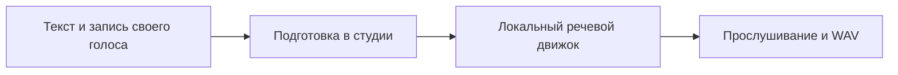

# Моя аудиокнига

**Локальная студия аудиокниг** — учебный проект для Windows: подготовка текста,
запись своего голоса и озвучивание на собственном компьютере. Идея проекта —
собрать эти действия в одном понятном интерфейсе и разобраться, как связать
обычное приложение с локальными речевыми моделями.

Цель — пройти путь от текста и записи до аудиокниги в WAV. Основные задачи:
сохранять проекты, разбивать текст на фрагменты, готовить записи для обучения
и давать возможность прослушать результат до озвучивания всей книги.



## Что уже есть

- Проекты, загрузка WAV и подтверждение голосового образца.
- Импорт русского текста, разбиение и правка произносимых фрагментов.
- Несколько текстов в проекте: общий сохранённый голос, отдельные фрагменты и WAV.
- Очередь озвучивания, проба голоса, прослушивание и сборка книги в WAV.
- Подготовка корпуса с расшифровкой, исправлением текста и исключением клипов.
- Дообучение VoxCPM2 через LoRA, сохранения, остановка и продолжение.

Сохранение обучения и короткие пробы проверялись с настоящим движком.
Сходство полученного голоса пока не принято: остаются вопросы к тембру,
темпу и интонации. В исходниках добавлены настройки вариации, шагов синтеза,
CFG, темпа и опорного клипа. На короткой пробе с настоящим движком проверены
выбор клипа, сохранение настроек в истории и замедление экспортируемого WAV
до 90%: получена запись на 17,2 секунды. Полная книга, остальные сочетания
параметров и самостоятельный сценарий с новой записью требуют проверки.

В обычной форме доступны выбор голоса и темпа; подробные настройки раскрываются
отдельно. При отсутствии черновика браузера восстанавливаются параметры
последнего готового результата в этом проекте.

Чтобы озвучить другой текст тем же голосом, нажмите «Добавить новый текст»
в текущем проекте. Книги переключаются через «Текст для озвучивания».
Предыдущие исходники, аудио и история сохраняются; повторное обучение не нужно.
Скачивание книги собирает только выбранный текст.

## Запуск интерфейса

Нужны Windows 10/11 x64, PowerShell, **.NET SDK 10.0.401** и **Node.js 24**.
Из корня репозитория:

```powershell
.\scripts\app\Start-LocalStudio.ps1 -Configuration Release
```

Скрипт собирает приложение и открывает браузер. При первой сборке могут
загружаться пакеты NuGet и npm. Python, модели и окружения движков
настраиваются отдельно; без них можно открыть интерфейс, но вычисления
недоступны. Готовой установки голосового движка одной кнопкой пока нет.

## Устройство

Стек: C# / .NET 10, ASP.NET Core, React, TypeScript, SQLite и Python.
Речевые задачи выполняются на CPU: VoxCPM2 и LoRA для синтеза и дообучения,
Whisper для расшифровки. Ранний режим RVC развивается отдельно.

```text
src/       приложение, интерфейс и Python-обработчики
workers/   ранний RVC-режим
tests/     проверки
scripts/   запуск и подготовка окружений
eng/       версии внешних ресурсов и патчи
docs/      описание проекта
```

Подробнее (даты обновления материалов):

- [Цель, работа приложения и ограничения](docs/PROJECT.md) — 29.10.2026.
- [Запуск на другом компьютере](docs/SETUP.md) — 26.10.2026.
- [Проверки](docs/TESTING.md) — 26.10.2026.
- [Внешние компоненты](THIRD_PARTY_NOTICES.md) — 26.10.2026.
- [Как подбирать голос и менять настройки генерации](docs/GENERATION.md) — 01.11.2026.
- [Презентация и материалы выступления](docs/presentation/README.md) — 26.10.2026.
- [Сравнение моделей и методика оценки](docs/report/audiobook-project.md) · [Word](docs/report/audiobook-project.docx) — 03.11.2026.
- [Краткая глава 1 и области применения](docs/report/chapter-1-voice-data-short.md) · [Word](docs/report/chapter-1-voice-data-short.docx) · [Схема](docs/report/chapter-1-applications.png) — 09.11.2026.
