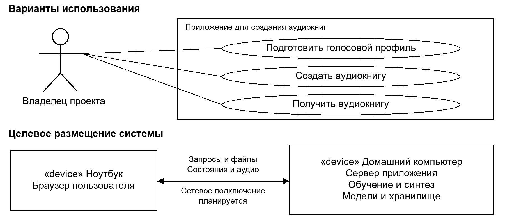

# Приложение для создания аудиокниг голосом пользователя

Синельников Вячеслав ФГИИБ-ПИ_1б+2024

3 ноября 2026 года

## 1 Назначение и задачи проекта

Предусматривается преобразование русскоязычных текстов в аудиокниги с использованием голоса пользователя. Приложение может применяться для озвучивания авторских произведений, материалов для прослушивания и предварительных реплик игровых персонажей. Для новых текстов используется ранее подготовленный голосовой профиль, поэтому запись произведения целиком не требуется.

**Цель проекта** — разработать клиент-серверное приложение для подготовки и дообучения голосового профиля пользователя и создания аудиокниг на русском языке с выполнением вычислений на серверном компьютере и управлением через браузер.

**Назначение приложения** — подготовка голосового профиля, преобразование текста в аудиозапись, прослушивание и сохранение результата.

Для достижения цели предусмотрены следующие задачи:

1. Проанализировать существующие решения и определить обязательные функции приложения.
2. Рассмотреть методы синтеза речи, сравнить готовые модели и выбрать основной и резервный варианты.
3. Спроектировать пользовательские сценарии, хранение данных и взаимодействие клиента с сервером.
4. Реализовать подготовку записи, дообучение голосового профиля и синтез аудиокниги.
5. Реализовать управление заданиями, прослушивание и экспорт результата.
6. Провести тестирование и отладку приложения, сравнить результаты озвучивания по единой методике.

В целевой схеме домашний компьютер выполняет обучение и синтез, а ноутбук используется для управления через браузер, в том числе во время демонстрации вне дома. В текущей версии предусмотрен запуск на одном компьютере. Подключение ноутбука к домашнему серверу относится к следующему этапу разработки.

## 2 Готовые модели и основание выбора

TTS (Text-to-Speech) означает преобразование текста в речь. При клонировании по образцу голос задаётся короткой записью без изменения весов модели. При дообучении параметры готовой модели или адаптера изменяются на записях пользователя. Полученный вариант далее обозначается как персональная дообученная модель. Конверсия голоса, например RVC, преобразует уже готовое аудио и требует отдельного источника речи.

В сравнение включены модели, которые поддерживают синтез на русском языке, локальный запуск и голос по образцу. Для выбора учитываются возможность дообучения на записях пользователя, лицензия весов и скорость синтеза на домашнем компьютере. Частота дискретизации указывается как техническая характеристика выходного файла.

Документированное дообучение означает, что разработчик опубликовал инструкцию, по которой можно подготовить записи с расшифровками и обучить модель или адаптер.

| Критерий | VoxCPM2 | XTTS v2 | Chatterbox Multilingual |
|---|---|---|---|
| Документированное дообучение | Полное дообучение и LoRA | Дообучение GPT-энкодера | Официальная инструкция для адаптации под голос пользователя не найдена |
| Лицензия весов | Apache-2.0 | CPML 1.0.0, некоммерческое использование модели и её результатов | MIT |
| Время синтеза на секунду аудио (RTF) | 0,634 с, медиана трёх замеров | Пока не измерено на этом ПК | Пока не измерено на этом ПК |
| Частота выходного аудио, кГц | 48 | 24 | 24 |

Источники сведений о моделях и лицензиях — [карточка VoxCPM2](https://huggingface.co/openbmb/VoxCPM2), [инструкция OpenBMB по дообучению](https://voxcpm.readthedocs.io/en/latest/finetuning/finetune.html), [документация Coqui](https://docs.coqui.ai/en/stable/models/xtts.html#training), [лицензия CPML](https://huggingface.co/coqui/XTTS-v2/raw/main/LICENSE.txt) и [официальный репозиторий Chatterbox](https://github.com/resemble-ai/chatterbox).

**Проверка скорости VoxCPM2.** На домашнем ПК с Intel Core i7-9700KF и NVIDIA GeForce RTX 2070 SUPER (8 ГБ) 20.11.2026 трижды синтезирована фраза «За окном медленно темнело, и в комнате стало тихо» после одного пробного прогона. Использовались готовые веса VoxCPM2 (BaseLM Q8_0, Acoustic F16), llama.cpp-omni b267, CUDA с переносом 24 слоёв на GPU и пример голоса OpenBMB. Seed 42, 10 шагов CFM, CFG 2,0.

| Замер | Время синтеза, с | Длительность WAV, с | RTF |
|---|---:|---:|---:|
| 1 | 2,436 | 3,84 | 0,634 |
| 2 | 2,422 | 3,84 | 0,631 |
| 3 | 2,440 | 3,84 | 0,635 |

При медиане RTF 0,634 темп этой пробы эквивалентен примерно 38 секундам синтеза на минуту аудио. Замер отражает этап синтеза по таймеру CLI после загрузки весов и подготовки образца. Для сравнения длинных текстов потребуется замер полного процесса по методике раздела 3 на том же оборудовании.

**Основание выбора.** VoxCPM2 выбрана основной моделью по трём причинам. Для неё опубликована процедура LoRA-дообучения, Apache-2.0 допускает использование модели в проекте, а пробный синтез на домашнем ПК прошёл быстрее реального времени. В отдельной пробе проекта выполнены два шага LoRA-дообучения на 16 секундах записи, второй — после восстановления сохранённого состояния. Полноценное дообучение в приложении и оценка качества по разделу 3 требуют дальнейших испытаний. XTTS v2 остаётся резервом для некоммерческого использования, Chatterbox Multilingual — кандидатом для сравнения.

## 3 Критерии качества и контрольные примеры

Сходство голоса не сводится к оценке «хорошо» или «плохо». Предусматривается сравнение с реальной записью диктора, а также сопоставление двух вариантов синтеза. Для каждого показателя фиксируются исходные данные, процедура и способ получения результата.

| Показатель | Процедура | Результат и предпочтение |
|---|---|---|
| Разборчивость | Независимая расшифровка аудио и сопоставление с эталонным текстом | WER = (замены + удаления + вставки) / число слов × 100%. Меньше лучше |
| Ударения | Прослушивание заранее отмеченных слов в заданном контексте | Число ошибочных ударений / число контрольных слов. Меньше лучше |
| Сходство голоса | Прослушивание образца диктора и двух анонимных вариантов синтеза | Число выборов каждого варианта как более близкого к образцу |
| Дефекты звучания | Отметка времени обрыва слова, повтора или постороннего звука | Перечень событий с типом и временем. Для сравнения используется один текст |
| Скорость | Один прогрев и три прогона на одном компьютере | RTF = время синтеза / длительность аудио. Медиана и диапазон. Меньше лучше |

Время RTF учитывает обработку текста, синтез и сборку аудио, но не обучение и загрузку модели. Холодный запуск учитывается отдельно. Перед вычислением WER регистр и пунктуация исключаются, числа раскрываются по эталонному чтению. Знаменатель — число слов эталона. WER не измеряет сходство голоса и правильность ударений. Автоматическое распознавание может использоваться как вспомогательный инструмент; его расшифровка проверяется по аудио.

Для экспертной оценки предлагается привлечь трёх оценщиков с опытом записи, редактирования или анализа речи. Опыт каждого фиксируется до прослушивания. При отсутствии такого опыта результаты обозначаются как оценки слушателей. Названия моделей скрываются, порядок A и B меняется. Используются одни и те же наушники, одинаковая громкость воспроизведения и неизменная скорость записи.

После образца диктора задаётся вопрос: «Какой вариант ближе к образцу по тембру голоса?» Ответы: «A», «B», «Различий не слышно», «Не могу оценить». Для каждого текста сравниваются все три пары моделей, порядок записей перемешивается. Для каждого ответа сохраняются обозначения записей и номер контрольного текста. Подсчитываются ответы каждого вида, ничьи и отказы не удаляются. Итоговый балл из разных показателей не рассчитывается. Предпочтение по тембру рассматривается отдельно от разборчивости и дефектов звучания.

Для первого показа предлагаются четыре примера. Эталонный текст задаёт ожидаемые слова, а в записи диктора проверяются произношение и голос.

| Пример | Входной текст | Что проверяется |
|---|---|---|
| Т1 | За окном медленно темнело, и в комнате стало тихо. | Слова без пропусков и повторов |
| Т2 | К 15 ноября подготовлены 24 страницы текста. | «К пятнадцатому ноября подготовлены двадцать четыре страницы текста» |
| Т3 | В старом замке заменили дверной замок. | Произношение «за́мке» и «замо́к» |
| Т4 | Вы вернётесь вечером? Да, после восьми. | Сохранение вопроса, ответа и границ фраз |

Для готовых моделей используется один исходный образец голоса, не содержащий контрольных текстов; необходимые преобразования формата фиксируются. Контрольные тексты и их чтение диктором не включаются в дообучение. Для каждой модели сохраняются аудиофайл, версия весов, параметры, время и результат проверки. Сначала сравниваются готовые модели. После получения персональной модели испытание повторяется на тех же текстах. Четыре примера позволяют показать процедуру и конкретные ошибки, но не обосновывают вывод о качестве на любых текстах. Численные результаты общего испытания пока не получены.

## 4 Функции роли и размещение системы

Предусматривается одна пользовательская роль — владелец проекта. Смена компьютера, с которого открыт браузер, не изменяет права. Отдельная роль администратора в текущий объём не включается. Функции сформулированы с позиции пользователя; сервер, модель и база данных являются частями системы.

| Объект | Доступные функции |
|---|---|
| Проект | Создание, открытие и удаление собственного проекта |
| Голос | Загрузка записи WAV, подготовка данных, запуск обучения и использование сохранённого профиля |
| Текст | Ввод или импорт TXT, просмотр и исправление произносимого текста |
| Задание | Запуск, просмотр состояния, приостановка, продолжение и отмена обработки |
| Результат | Прослушивание фрагментов, повторная озвучка и сохранение общего WAV-файла |

Целевая схема предусматривает размещение API, модели, обработчика заданий и хранилища на домашнем компьютере. Через браузер передаются исходные данные и команды, отображаются состояния и полученное аудио. Обучение выполняется на сервере. Способ подключения из другой сети и проверка доступа определяются при реализации удалённого режима. Подключение второго компьютера сейчас не реализуется.

**Подготовить голосовой профиль.** Актор: владелец проекта. Предусловие: создан проект и имеется запись собственного голоса. Сценарий: загружается WAV, проверяется запись, запускается подготовка и обучение, сохраняется профиль. Отклонение: неподходящий формат или прерывание задания. Результат: сохранённый профиль либо сообщение о причине незавершения.

**Создать аудиокнигу.** Актор: владелец проекта. Предусловие: подготовлены голос и текст. Сценарий: текст проверяется и разбивается на фрагменты, запускается синтез, отображается ход обработки. Отклонение: ошибка фрагмента или отмена задания. Результат: созданные аудиофрагменты и состояние задания.

**Получить аудиокнигу.** Актор: владелец проекта. Предусловие: имеются завершённые фрагменты. Сценарий: записи прослушиваются, при необходимости выбранный фрагмент озвучивается повторно, собирается и сохраняется WAV. Отклонение: отсутствует необходимый фрагмент. Результат: аудиофайл либо указание, какую часть требуется завершить.

Результат каждого этапа разработки оформляется отдельной проверяемой задачей. Для неё указываются ожидаемый результат и способ проверки, а изменения отражаются в истории Git.

(Исправлено в пункте 2)
