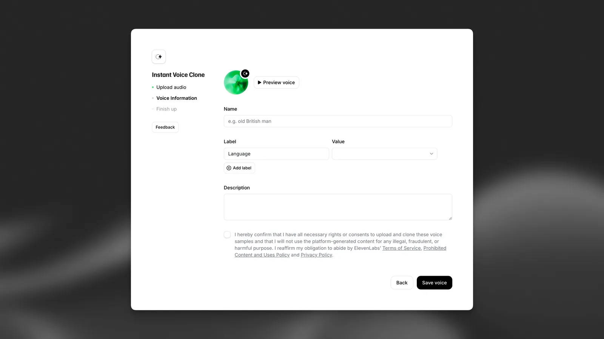
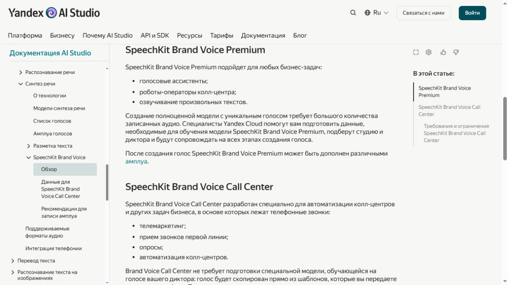
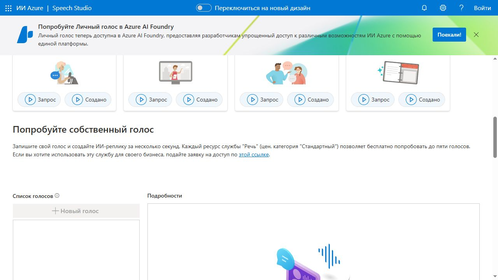
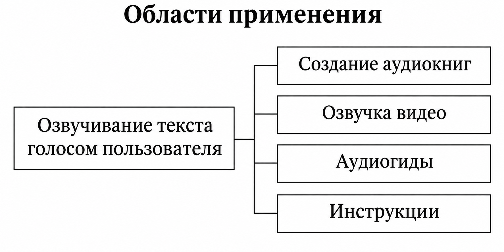

# Глава 1 Обработка голосовых данных

Синельников Вячеслав. Обновлено 09.11.2026.

## 1.1 Особенности обработки голосовых данных

Для работы используются запись одного диктора и текст для озвучивания. Запись должна быть без музыки, сильного шума, эха и обрезанных слов. Перед дообучением она делится на фразы, а расшифровка проверяется прослушиванием. Неподходящие фрагменты исключаются.

Рабочие записи сохраняются в WAV. Частота и число каналов приводятся к требованиям модели. В тексте раскрываются числа и сокращения, проверяются «ё» и ударения. Контрольные фразы и их записи хранятся отдельно и не включаются в обучение.

## 1.2 Принципы организации нейросетевых моделей

Синтез речи TTS преобразует текст в аудио. Модель получает текст и сведения о голосе, формирует речевое представление, затем восстанавливается звук. Конкретные этапы зависят от архитектуры.

При синтезе по образцу запись задаёт голос без изменения весов модели. При дообучении параметры изменяются на записях диктора. LoRA позволяет обучать небольшой адаптер вместо всех весов. Для нового текста можно повторно использовать сохранённый голос.

| Модель | Роль в проекте | Возможности |
|---|---|---|
| VoxCPM2 | Основная | Голос по образцу, дообучение и LoRA |
| XTTS v2 | Резервная | Голос по образцу, дообучение |
| Chatterbox Multilingual | Для сравнения | Голос по образцу, поддержка русского языка |

Все три модели поддерживают русский язык. Пригодность резерва проверяется на целевом компьютере.

## 1.3 Метрики и методы оценки качества голосовых моделей

| Показатель | Проверка | Результат |
|---|---|---|
| Точность чтения | Расшифровка сопоставляется с эталоном | WER = (S + D + I) / N × 100% |
| Ударения | Прослушиваются выбранные слова | Ошибки / число проверяемых слов |
| Сходство голоса | Сравниваются образец диктора и два варианта синтеза | Предпочтения A или B, ничьи и отказы |
| Дефекты | Отмечаются обрывы, повторы и шумы | Число дефектов и время появления |
| Скорость | Прогрев и три прогона на одном компьютере | RTF = время обработки / длительность аудио |

В формуле WER S — замены слов, D — пропуски, I — вставки, N — число слов эталона. Расшифровка выполняется без просмотра эталона. Регистр и пунктуация исключаются, числа записываются словами. Ошибки автоматической расшифровки проверяются по аудио. Меньшие WER, доля ошибочных ударений, число дефектов и RTF предпочтительнее. Загрузка модели и обучение в RTF не входят; приводятся медиана и диапазон трёх прогонов.

Для экспертной оценки предусматриваются три человека с опытом работы с речью; без такого опыта используются оценки слушателей. Названия моделей скрываются, порядок записей меняется, наушники и громкость одинаковы.

Вопрос: «Какой вариант ближе к образцу по тембру?» Ответы: «A», «B», «Различий не слышно», «Не могу оценить». Для трёх моделей проверяются все три пары на одном тексте; сохраняются все ответы. Общий балл из разных показателей не рассчитывается.

Для первой проверки берутся четыре коротких текста: обычная фраза, предложение с числами, слова «за́мке» и «замо́к» в контексте, вопрос с ответом. Используется один образец голоса вне контрольного набора. После дообучения испытание повторяется на тех же текстах. Результаты такого сравнения пока не получены.

## 1.4 Сравнение существующих сервисов

Сравниваются три облачных сервиса из таблицы от 9 ноября. Они озвучивают русский текст голосом диктора. Тарифы сверены 20.11.2026.

| Критерий | ElevenLabs IVC | SpeechKit Brand Voice Premium | Azure Speech Personal Voice |
|---|---|---|---|
| Как создаётся голос | Пользователь загружает короткий образец голоса | Поставщик помогает подготовить корпус записей и создать голос по заявке | Для создания голоса нужны образец и запись согласия диктора. Для использования API требуется одобрение Microsoft |
| Как оплачивается | Платная подписка Starter или выше. Бесплатный тариф включает синтез готовыми голосами | Ежемесячный хостинг по индивидуальной цене и оплата за запросы на синтез | Создание профиля бесплатно. Хранение и синтез оплачиваются по факту использования. В демо можно бесплатно попробовать до пяти голосов на ресурс Standard |

Само звучание сравнивается по методике раздела 1.3.

ElevenLabs Instant Voice Cloning. [Руководство](https://elevenlabs.io/docs/eleven-creative/voices/voice-cloning/instant-voice-cloning) · [Тарифы](https://elevenlabs.io/pricing)

Yandex SpeechKit Brand Voice Premium. [Описание услуги](https://aistudio.yandex.ru/ru/docs/speechkit/tts/brand-voice/#premium) · [Тарифы](https://aistudio.yandex.ru/ru/docs/speechkit/pricing#brand-voice)

Azure Speech Personal Voice. [Демонстрация](https://speech.microsoft.com/portal/PersonalVoice) · [Условия доступа](https://learn.microsoft.com/en-us/azure/ai-services/speech-service/personal-voice-overview) · [Тарифы](https://azure.microsoft.com/en-gb/pricing/details/speech/)

Для собственного приложения необходимы подготовка голоса, правка текста, синтез по фрагментам, прослушивание и экспорт WAV. Обучение и синтез выполняются на домашнем компьютере. Управление с ноутбука через браузер предусмотрено следующим этапом; сейчас приложение запускается на одном компьютере.

<!-- pagebreak -->

Один подготовленный голос используется для четырёх основных задач.

Рисунок 1 — Практические применения синтеза речи голосом пользователя

Для аудиокниги озвучивается произведение, для видео — закадровый текст, для аудиогида — описания объектов, для инструкции — порядок действий. Звук для видео добавляется в видеоредактор.

(Исправлено в пункте 1.4)
