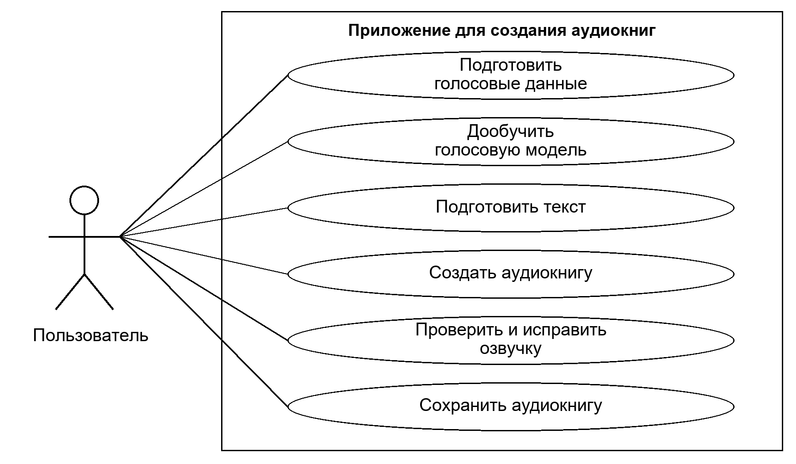

# Глава 1 Анализ обработки голосовых данных

Синельников Вячеслав. Обновлено 09.11.2026.

## 1.1 Особенности обработки голосовых данных

Для создания аудиокниги голосом пользователя требуются запись речи, её точная расшифровка и текст для озвучивания. Запись используется для передачи особенностей голоса. Расшифровка связывает звук с произнесёнными словами, если она требуется выбранной моделью. Текст будущей книги подготавливается отдельно.

Качество исходной записи влияет на результат. Фоновая музыка, эхо, перегрузка микрофона и речь нескольких людей затрудняют выделение голоса. Поэтому отбираются записи одного диктора с устойчивой громкостью. Для рабочего корпуса используется WAV. Число каналов и частота дискретизации приводятся к требованиям модели; увеличение частоты готовой записи не восстанавливает потерянные звуки.

Перед дообучением запись разбивается на законченные фразы. Обрезанные слова, посторонние звуки и неразборчивые участки исключаются. Автоматическая расшифровка проверяется прослушиванием: текст каждого фрагмента должен совпадать с записью. В тексте для синтеза отдельно раскрываются числа и сокращения, проверяются буква «ё» и неоднозначные ударения.

Материалы для проверки отделяются от обучающего корпуса. Контрольные фразы и их записи не используются при дообучении. Исходная запись сохраняется вместе с исправленной разметкой, чтобы можно было повторить подготовку данных.

## 1.2 Принципы организации нейросетевых моделей для обработки голосовых данных

Синтез речи TTS преобразует текст в звуковой сигнал. В общем случае сначала формируется представление текста, затем предсказываются речевые признаки или звуковые коды, после чего восстанавливается аудио. В одних моделях эти этапы разделены, в других объединены. Порядок работы и формат промежуточных данных зависят от архитектуры.

Для передачи голоса применяются два подхода. При синтезе по образцу запись используется как условие генерации без изменения весов. При дообучении параметры готовой модели или адаптера изменяются на корпусе диктора. LoRA позволяет обучать небольшой набор дополнительных параметров вместо всех весов модели.

| Модель | Работа с голосом | Применение в проекте |
|---|---|---|
| VoxCPM2 | Образец голоса, полное дообучение и LoRA | Основной вариант |
| XTTS v2 | Образец голоса, дообучение GPT encoder | Резерв для испытаний |
| Chatterbox Multilingual | Образец голоса, многоязычный синтез | Дополнительный вариант для сравнения |

Для всех трёх моделей документирована поддержка русского языка. Выбор резерва подтверждается запуском на целевом компьютере и испытаниями по единой методике. Распознавание речи используется при подготовке расшифровок. Преобразование голоса RVC решает другую задачу: изменяет уже существующее аудио и само по себе не заменяет TTS.

<!-- pagebreak -->

## 1.3 Метрики и методы оценки качества голосовых моделей

Качество оценивается по отдельным показателям. Правильно произнесённый текст может звучать чужим голосом, а похожий голос может содержать пропуски слов. Поэтому разборчивость, произношение и сходство проверяются раздельно.

| Показатель | Как измеряется | Результат |
|---|---|---|
| Точность чтения | Независимая расшифровка аудио сопоставляется с эталонным текстом | WER = (S + D + I) / N × 100%. Меньше лучше |
| Правильность ударений | Прослушиваются заранее выбранные слова в заданном контексте | Ошибочные ударения / число проверяемых слов. Меньше лучше |
| Сходство голоса | После записи диктора сравниваются два анонимных варианта синтеза | Число предпочтений каждого варианта, ничьих и отказов от оценки |
| Дефекты звучания | Отмечаются обрывы, повторы и посторонние звуки | Число дефектов на одном тексте и журнал с временем появления. Меньше лучше |
| Скорость обработки | На одном компьютере выполняются прогрев и три прогона | RTF = время обработки / длительность аудио. Медиана и диапазон; меньше лучше |

В формуле WER S означает замены слов, D — пропуски, I — вставки, N — число слов эталона. Регистр и пунктуация исключаются, числа записываются словами по эталонному чтению. Расшифровка выполняется без просмотра эталона. Автоматический распознаватель допускается как вспомогательный инструмент; его ошибки проверяются по аудио. WER не показывает сходство голоса и правильность ударений.

Для экспертного сравнения предусматриваются три оценщика с опытом записи, редактирования или анализа речи. Опыт фиксируется заранее. При отсутствии такого опыта результаты обозначаются как оценки слушателей. После образца диктора задаётся один вопрос: «Какой вариант ближе к образцу по тембру?» Ответы: «A», «B», «Различий не слышно», «Не могу оценить».

Названия моделей скрываются, порядок A и B меняется. Наушники, громкость и скорость воспроизведения сохраняются одинаковыми. Для трёх моделей проверяются все три пары на каждом тексте. Ответы сохраняются отдельно по оценщикам; при расхождении мнений приводится распределение голосов. Ничьи и отказы не исключаются. Общий балл из разных показателей не рассчитывается.

Для первого испытания достаточно четырёх контрольных фраз:

1. «За окном медленно темнело, и в комнате стало тихо» — пропуски и повторы.
2. «К 15 ноября подготовлены 24 страницы текста» — чтение чисел.
3. «В старом замке заменили дверной замок» — ударения «за́мке» и «замо́к».
4. «Вы вернётесь вечером? Да, после восьми» — вопрос, ответ и паузы.

Используется один образец голоса вне контрольного набора. Сохраняются версии моделей, настройки, аудио и результаты. Время RTF включает подготовку текста, синтез и сборку звука; загрузка модели и обучение не учитываются. Холодный запуск измеряется отдельно. Эти четыре фразы служат для демонстрации процедуры; для вывода о качестве на длинных текстах потребуется расширенный набор. Результаты общего испытания пока не получены.

<!-- pagebreak -->

## 1.4 Сравнение существующих сервисов

Для сравнения выбраны три облачных предложения: ElevenLabs с Instant Voice Cloning (IVC, создание голоса по короткому образцу), Yandex SpeechKit Brand Voice Premium и Azure Speech Personal Voice. Сопоставляются возможности создания голоса и условия использования. Готовые модели из раздела 1.2 рассматриваются отдельно, поскольку их можно включить в собственное приложение.

Критерии связаны с задачей проекта: требуется озвучивать русский текст своим голосом и управлять обработкой из приложения через программный интерфейс API. Наличие функции проверяется по документации выбранного предложения. Для двоичных признаков используются только «Да» и «Нет»; при недостатке сведений — «Не установлено». Условия подключения приводятся отдельно от наличия функции.

| Критерий | ElevenLabs IVC | SpeechKit Brand Voice Premium | Azure Speech Personal Voice |
|---|---|---|---|
| Русский язык | Да | Да | Да |
| Произвольный текст голосом диктора | Да | Да | Да |
| Подключение через API | Да | Да | Да |
| Создание голоса без предварительной заявки поставщику | Да | Нет | Нет |
| Где выполняется синтез в выбранном предложении | Облако | Облако | Облако |
| Способ подготовки голоса | Загрузка короткого образца | Подготовка корпуса с поставщиком | Образец и запись согласия диктора |

Сведения проверены 09.11.2026. Первые три строки служат условиями пригодности: одинаковые значения не доказывают превосходство сервиса. Порядок подключения и подготовки голоса показывает различия в начале работы. Категории не переводятся в баллы, общий рейтинг не рассчитывается. Качество звучания требует отдельного испытания по разделу 1.3.

В ElevenLabs голос IVC создаётся через интерфейс по загруженной записи; рекомендуется 1–2 минуты чистой речи. Голос можно применять через API. Для работы с длинными текстами предусмотрен редактор аудиокниг с главами и экспортом WAV или MP3. Возможности зависят от тарифа.

В SpeechKit сравнивается именно Brand Voice Premium: создание голоса организуется как отдельный проект с поставщиком, включая подготовку записей. Brand Voice Lite в сравнение не включается, поскольку эта функция отключена с 10.10.2026. Возможности Premium нельзя автоматически переносить на остальные режимы SpeechKit.

Для Azure Personal Voice требуется согласование доступа к API. Профиль создаётся по записи речи длительностью 5–90 секунд и отдельному аудиосогласию диктора. Допуск зависит от заявленного сценария использования. Наличие демонстрации не означает свободного доступа к API.

По результатам сравнения для собственного приложения выделяются обязательные функции: подготовка голоса, ввод и исправление текста, синтез по фрагментам, прослушивание и экспорт. Дополнительное требование проекта — выполнение обучения и синтеза на домашнем компьютере с управлением через браузер. Оно определяет размещение вычислений; преимущество по качеству или скорости должно подтверждаться измерениями.

<!-- pagebreak -->

## Диаграмма вариантов использования

Предусматривается одна роль — пользователь, работающий со своими записями и текстами. Сервер и модель входят в состав системы. Подключение с другого компьютера не создаёт отдельной роли.

Рисунок 1 — Диаграмма вариантов использования приложения

Сценарии описывают целевую работу системы. Дообучение требуется при подготовке персональной модели; при использовании уже сохранённого профиля оно повторно не выполняется.

**Подготовка голоса.** Предусловие: создан проект и имеется запись. Загружается WAV, проверяются фрагменты и расшифровки, сохраняется корпус. Затем при необходимости запускается дообучение. Результат: подтверждённый корпус; после дообучения — сохранённая модель. При неподходящем формате выводится причина отказа; прерванное обучение продолжается из доступного сохранения.

**Создание аудиокниги.** Предусловие: подготовлены текст и голосовой профиль. Выбираются голос и параметры, запускается обработка фрагментов. Результат: аудиофрагменты и состояние задания. Ошибка отдельного фрагмента отображается пользователю; доступные результаты сохраняются.

**Проверка и сохранение.** Предусловие: имеются синтезированные фрагменты. Записи прослушиваются, ошибочный текст исправляется и озвучивается повторно. После завершения собирается WAV. Результат: сохранённая аудиокнига. Если необходимый фрагмент отсутствует, указывается, какую часть требуется завершить.

В текущей реализации интерфейс и сервер запускаются на одном компьютере. Целевая клиент-серверная схема предусматривает работу браузера на ноутбуке, а обучения, синтеза и хранилища — на домашнем компьютере. Подключение из другой сети относится к следующему этапу разработки.
